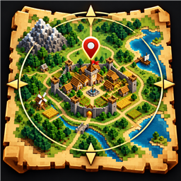

# MapColonies



https://github.com/VolcanicMG/MapColonies

NeoForge 1.21.1 mod by VolcanicMG that draws MineColonies colony borders and hut footprints on Xaero's Minimap and Xaero's
World Map, correctly in multiplayer.

- Each colony's claimed chunks are tinted in its team colour, with a stronger border where the claim ends.
- Colonies you belong to are drawn stronger than other colonies.
- Huts are drawn as block-accurate footprints (from the building's schematic corners).
- Each hut gets its own block icon at the footprint centre with a label under it (e.g. `Builder 3`; the Town Hall
  shows the colony name), on both maps. Labels can be always on, hover-only or off per map, and hide on the world
  map when zoomed far out.
- Hovering a claimed chunk shows the colony name.

## Install

Put the jar on the server and on every client that should see borders.

| Side | Requires | Optional |
|---|---|---|
| Server | NeoForge 21.1.262+, MineColonies | — |
| Client | NeoForge 21.1.262+, MineColonies | Xaero's Minimap, Xaero's World Map |

Without Xaero's mods the client receives the data but draws nothing. A dedicated server never loads any Xaero or
client classes.

## How multiplayer works

The server is the source of truth. It reads every colony's claimed chunks (MineColonies claim data), name, team
colour and huts, and sends each player their own view:

- on login: a full sync (every packet covers all dimensions);
- every `syncIntervalSeconds`: only the colonies that changed for that player, plus removals.

**Membership** uses MineColonies' own permission check (`IPermissions#isColonyMember`), so owners, officers,
friends and any custom member rank count. Membership is checked per player per sync, so being added to or removed
from a colony shows up within one interval. Hostile and Neutral ranks do not count. FTB Teams is not involved.

The network channel is optional: a client with the mod can join a server without it (nothing is drawn), and a
server with the mod only sends to clients that have it.

Huts of colonies you are not a member of are only sent when the server allows it (`showOtherColoniesBuildings`).

## Config

Server (`<world>/serverconfig/mapcolonies-server.toml`):

| Key | Default | Meaning |
|---|---|---|
| `showAllColonies` | `true` | Also send colonies the player is not a member of (drawn dimmer). |
| `showOtherColoniesBuildings` | `false` | Also send huts of those colonies. |
| `syncIntervalSeconds` | `5` | Seconds between diff syncs. |

Client (`config/mapcolonies-client.toml`):

| Key | Default | Meaning |
|---|---|---|
| `enabled` | `true` | Master switch. |
| `showOnMinimap` / `showOnWorldMap` | `true` | Colony claims per map. |
| `outlineOnly` | `false` | Only borders, no fill. |
| `fillOpacityOwn` / `fillOpacityOther` | `35` / `15` | Claim fill, percent. |
| `borderOpacityOwn` / `borderOpacityOther` | `85` / `50` | Claim border, percent. |
| `buildings.showBuildings` | `true` | Master switch for huts. |
| `buildings.buildingsOnMinimap` / `buildingsOnWorldMap` | `true` | Huts per map. |
| `buildings.buildingLabels` | `NAME_LEVEL` | Label text: `NONE`, `NAME`, `NAME_LEVEL`. |
| `buildings.onlyMyColonies` | `true` | Only huts of colonies you are a member of. |
| `buildings.minBuildingLevel` | `0` | `0` also shows placed, unbuilt huts. |
| `buildings.buildingColorMode` | `COLONY` | `COLONY` colour or a stable per-`TYPE` colour. |
| `buildings.buildingFillOpacity` / `buildingBorderOpacity` | `45` / `95` | Hut footprint, percent. |
| `buildings.hiddenBuildingTypes` | `[]` | Type ids to skip, e.g. `"minecolonies:postbox"` or `"stash"`. |
| `buildings.buildingIcons` | `true` | Hut icon at each footprint centre. |
| `buildings.iconsOnMinimap` / `iconsOnWorldMap` | `true` | Icons per map. |
| `buildings.labelModeMinimap` / `labelModeWorldMap` | `ALWAYS` | `ALWAYS` under the icon, `HOVER`, or `NONE`. Minimap `HOVER` uses the info display line for the block you stand on. |
| `buildings.worldMapLabelMinZoom` | `1.0` | Hide world map labels (icons stay) below this zoom. |
| `buildings.iconScale` | `1.0` | Icon and label size multiplier. |
| `buildings.iconBackground` | `true` | Black rounded badge with a white outline behind hut icons. |
| `buildings.labelScale` | `1.0` | Label text size, relative to the icon. |

Client config changes apply live. Edit them in game from Mods > MapColonies > Config, or with the
**MapColonies…** button that appears in a free corner of Xaero's Minimap settings and World Map settings screens
(Back returns to Xaero's screen).

## How it hooks into Xaero

Xaero exposes a chunk highlighter API (the one Open Parties and Claims uses) but only registers its own
highlighters. Two small client-only mixins add ours to each map's `HighlighterRegistry` right before it is frozen
(`end()`). A mixin plugin skips each mixin when its Xaero mod is absent.

Hut icons and labels use Xaero's element renderer system (the one waypoints and tracked players use). Those
handlers have a public `add`, so the renderers are registered on the first client tick after each map has built
its handler; no mixin is involved.

## Build

```sh
mkdir -p libs   # copy the exact pack jars listed in build.gradle into libs/ (gitignored);
                # xaerolib comes from META-INF/jarjar/ inside the Xaero jars
JAVA_HOME=/path/to/jdk-21 ./gradlew build
```

The jar lands in `build/libs/mapcolonies-1.0.1.jar`. The pack jars are `compileOnly`, so any API mismatch with
those exact versions fails the build. `./gradlew runServer` starts a dev server with the MineColonies stack (no
Xaero).

## License

MIT
